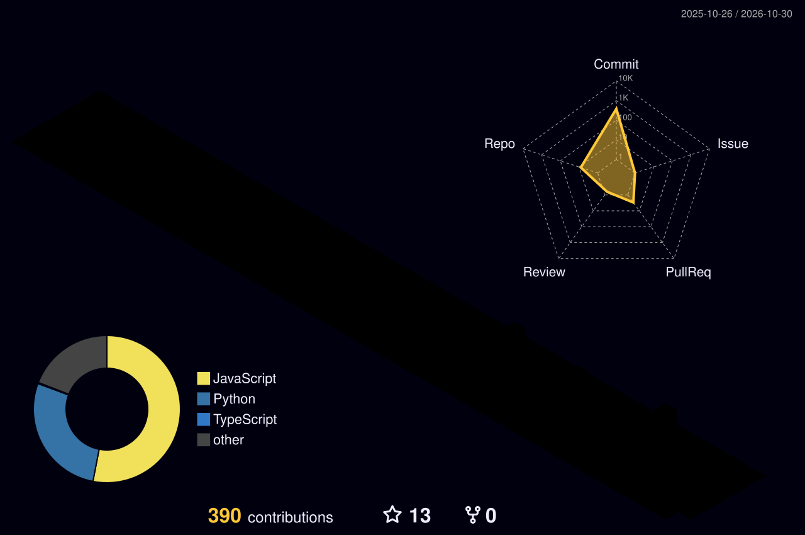

 

---

## About Me

19 yo dev based between France and Türkiye
I build clean, fast software, currently studying cybersecurity while working as a CISO.

* Studying Computer Science
* Taking freelance clients
* Always working on something new
* Of course sometimes I work with AI, but I understand what I build with it

---

## Tech Stack

### `01` — Languages & Markup

### `02` — Frontend Development

### `03` — Mobile Development

### `04` — Backend & APIs

### `05` — Databases & Data Science

### `06` — Cybersecurity & Networking

### `07` — Operating Systems

### `08` — DevOps, Cloud & CI/CD

### `09` — Testing & Code Quality

### `10` — IDEs & Creative Tools

## GitHub Stats

 

---

<picture>
  <source media="(prefers-color-scheme: dark)" srcset="https://raw.githubusercontent.com/1337europol/1337europol/output/github-contribution-grid-snake-dark.svg" />
  <source media="(prefers-color-scheme: light)" srcset="https://raw.githubusercontent.com/1337europol/1337europol/output/github-contribution-grid-snake.svg" />
  
</picture>

---

## My contributions

---

## Contact

